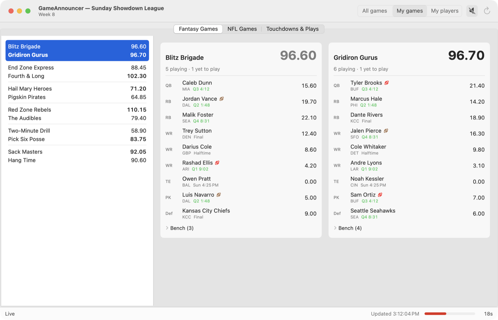
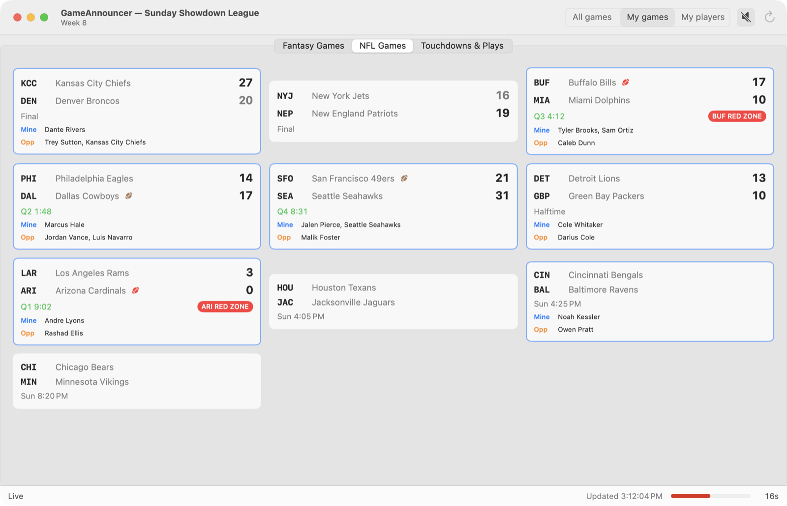
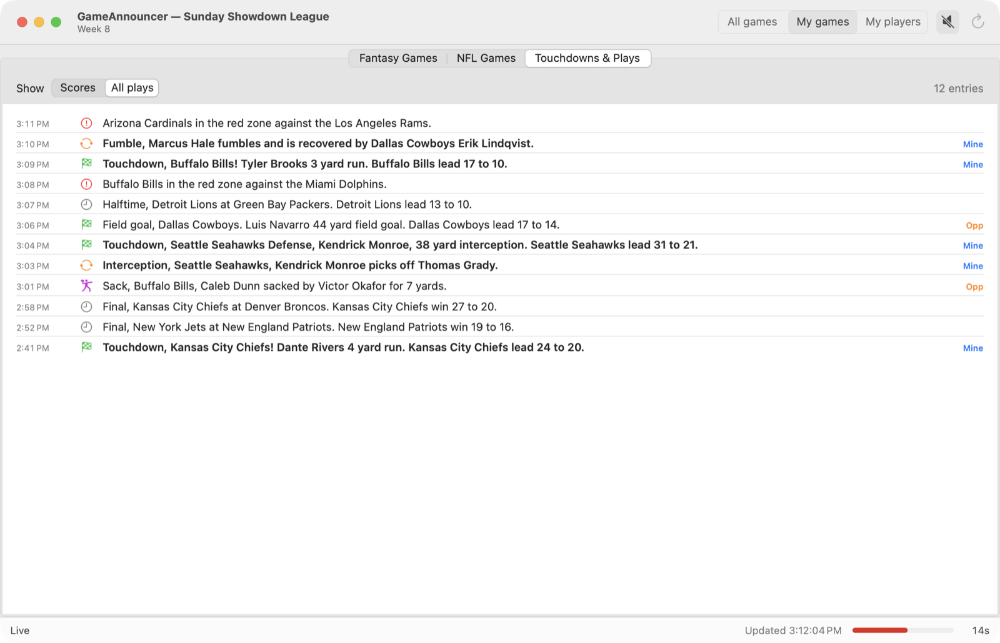

# GameAnnouncer

**Live scoring and announcements for MyFantasyLeague**, on the Mac.

Live fantasy football scoring for [MyFantasyLeague](https://www.myfantasyleague.com) leagues, with spoken play-by-play announcements. It's inspired by MFL's old Windows GameDay program, which called out touchdowns, field goals, red-zone trips and sacks as they happened.

> Not affiliated with or endorsed by MyFantasyLeague, ESPN or the NFL.

## What it does

*Screenshots use a fictional demo league (`GameAnnouncer -demo YES`).*

### Fantasy Games

Every matchup in your league, with live scores. Select one to see both teams' starters side by side, with points, game clock, and who has the ball (🏈) or is in the red zone (red 🏈).

<picture>
  <source media="(prefers-color-scheme: dark)" srcset="docs/screenshots/fantasy-dark.png">
  
</picture>

### NFL Games

Every game this week with score, clock, possession and red zone, plus which of your starters and your opponents' are playing in it.

<picture>
  <source media="(prefers-color-scheme: dark)" srcset="docs/screenshots/nfl-dark.png">
  
</picture>

### Touchdowns & Plays

A running log of scores, turnovers, sacks and red-zone trips, tagged when they involve your players or your opponent's.

<picture>
  <source media="(prefers-color-scheme: dark)" srcset="docs/screenshots/plays-dark.png">
  
</picture>

### Announcements

Every play in the log is spoken with macOS's built-in voices, for example:

- "Touchdown, Seattle Seahawks Defense, Kendrick Monroe, 38 yard interception."
- "Sack, Buffalo Bills, Caleb Dunn sacked by Victor Okafor for 7 yards."

You can announce every NFL game, only games with your matchup's starters, or only plays by those starters. Each type of announcement can be turned off, and you can pick the voice.

Scores refresh every 30 seconds while games are on. Between game windows, the app waits until shortly before the next kickoff.

## Requirements

- macOS 14 or later
- Xcode 26 or later to build. The Command Line Tools alone aren't enough, because SwiftUI's `@State` macro ships only with Xcode.

## Build and run

```bash
git clone https://github.com/darcuri/gameannouncer.git
cd gameannouncer
scripts/make-app.sh --open   # builds and opens dist/GameAnnouncer.app
```

Or run it straight from the source tree:

```bash
swift run GameAnnouncer
```

On first launch, enter your league ID and pick your team.

### Finding your league ID

Open your league's home page on myfantasyleague.com. The league ID is the number at the end of the address, for example `https://www##.myfantasyleague.com/2026/home/12345`.

### Private leagues

Public leagues work as is. For a private league, get an API key from **Help → Developer's API** on your league's site. Then run the app with that key in the `MFL_APIKEY` environment variable:

```bash
MFL_APIKEY=your-key swift run GameAnnouncer
```

## Development

```bash
swift test                            # unit tests
swift run gameannouncer-record --league ID  # record live API responses to Fixtures/ during games
swift run gameannouncer-replay Fixtures/2026-W08 --franchise ID --speak   # replay recordings through the announcer
swift run GameAnnouncer -demo YES     # fictional league; no network, saves no settings
```

To regenerate the screenshots (needs Screen Recording permission for your terminal):

```bash
for look in light dark; do
  swift run GameAnnouncer -demo YES -snapshotDir /tmp/shots -snapshotAppearance $look
done
for f in /tmp/shots/*.png; do sips -Z 1600 "$f" --out "docs/screenshots/$(basename "$f")"; done
```

[ARCHITECTURE.md](ARCHITECTURE.md) covers the data sources, the event detection and what was learned from recording live games.

## Data sources

- **MyFantasyLeague's [public API](https://api.myfantasyleague.com/2026/api_info):** league, rosters, players and live fantasy scoring.
- **ESPN's public scoreboard and game summary endpoints:** NFL game state and play-by-play. These are undocumented and may change without notice.

## Privacy

Your league ID, team and preferences are stored only on your Mac. The app talks only to MyFantasyLeague and ESPN, and collects nothing.

## License

[MIT](LICENSE)
